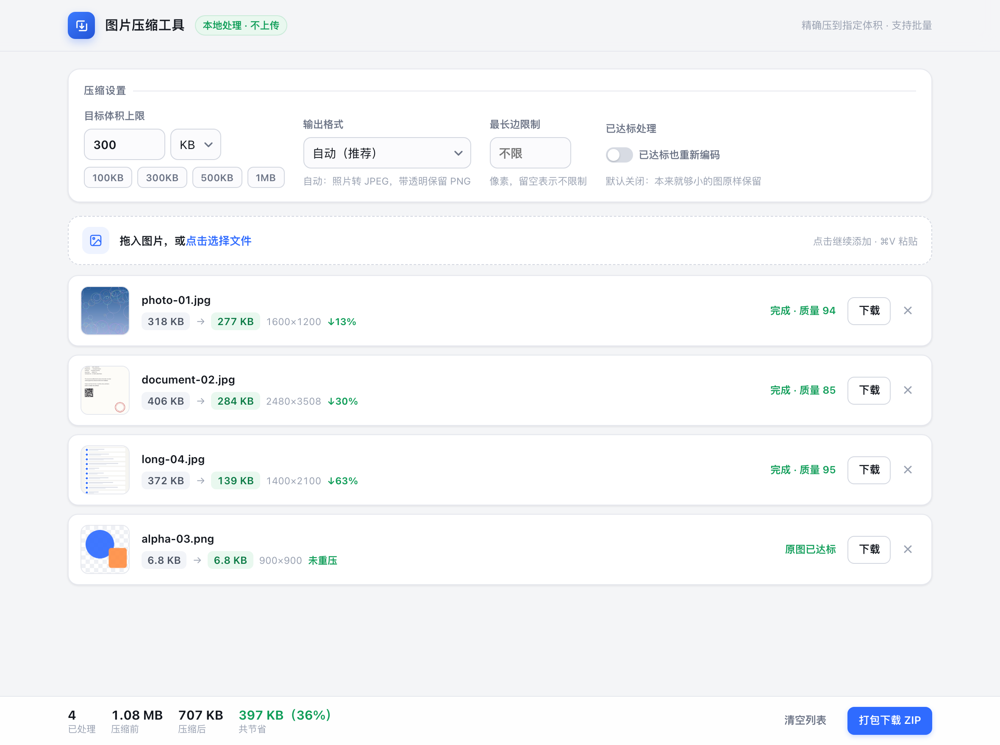

<div align="center">

# 图片压缩工具

**把图片精确压到指定体积 —— 纯本地、单文件、零依赖**

[](#)
[](#)
[](#)
[](#)
[](#)

一个用来应付「上传图片不得超过 300KB」这类硬性限制的小工具。
给定体积上限，它保证输出的图片一定在限制之内，并且尽量保留尺寸与画质。

</div>

---



## 这是什么

很多系统对上传图片有体积限制：300KB、500KB、1MB。常见的在线压缩网站要么上传到别人服务器、要么只能"凭感觉"拉一个画质滑块，压完还是超标，得反复试。

这个工具换了个思路：**你给上限，它来想办法**。对每张图，它在画质和尺寸两个维度上搜索，找到一个刚好不超标的组合，并把这个组合（画质值、缩放比例）如实报给你。整个过程在浏览器内存里完成，图片不出本机。

整份代码是一个 `.html` 文件，双击即用，不联网、不装依赖、不需要 Node 或 Python。

## 特性

| 能力 | 说明 |
| --- | --- |
| **精确体积控制** | 输出保证 ≤ 设定上限，不是"大概差不多" |
| **画质优先** | 先降画质，实在压不下来才缩尺寸；同一张图不会无谓掉分辨率 |
| **批量处理** | 多选、拖拽、粘贴三种导入方式，一次处理任意张数 |
| **智能格式** | 照片/无透明 PNG 自动转 JPEG（体积收益最大），带透明通道的保 PNG |
| **不糟蹋小图** | 原图本来就在上限内的，原样保留，绝不重新编码 |
| **方向修正** | 读取并固化 EXIF 方向，手机竖拍图不会输出成侧倒的 |
| **一键打包** | 内置 ZIP 打包（STORE + CRC32），全部结果一次下载 |
| **离线可用** | 无 CDN、无网络请求，断网照样跑 |

## 快速开始

```bash
# macOS 直接打开
open "图片压缩工具.html"

# 或者：文件管理器里双击图片压缩工具.html
```

Windows / Linux 上双击同一个文件即可，浏览器会打开它。

> [!NOTE]
> 首次使用建议用 Chrome、Edge 或 Safari 的较新版本。工具依赖 Canvas 与 `createImageBitmap`，IE 与现代版本之前的旧浏览器不支持。

## 使用方式

### 1. 设定目标体积

左上角输入数字，单位可选 **KB / MB**（默认 300 KB）。下方四个快捷按钮可以一键切到 100KB / 300KB / 500KB / 1MB。

其余三项按需调整，不懂就保持默认：

- **输出格式**：默认「自动（推荐）」，其余选项强制 JPEG / PNG / WebP。
- **最长边限制**：留空表示不限尺寸；填 `1600` 之类会把长边压到该像素，顺带减小体积。
- **已达标也重新编码**：默认关闭。开启后，即使原图没超限也会重新压缩一遍（想要"尽可能小"时用）。

### 2. 导入图片

三种方式，任选：

| 方式 | 操作 |
| --- | --- |
| 拖拽 | 把文件或文件夹里的图片直接拖进灰色区域（拖到页面任意位置都行） |
| 点击选择 | 点击虚线框，多选文件 |
| 粘贴 | <kbd>⌘</kbd> + <kbd>V</kbd>（Windows 为 <kbd>Ctrl</kbd> + <kbd>V</kbd>），直接贴截图 |

支持 JPG / PNG / WebP / GIF。导入后立刻开始压缩，不需要额外点"开始"。

### 3. 检查结果

每张图一行，从左到右依次是：缩略图、原始体积 → 压缩后体积、尺寸变化、状态。

状态文字会告诉你它做了什么，例如：

```
完成 · 质量 95              # 只调了画质，尺寸没动
完成 · 质量 85 · 转 JPG     # 调了画质，并且转换了格式
完成 · 质量 76  1400×1050   # 同时缩了尺寸，右侧会显示新尺寸
原图已达标                   # 本来就是小图，原样保留
```

点击缩略图会在新标签页打开压缩后的图片，用来放大确认清晰度。

### 4. 下载

- **单张**：点该行右侧「下载」。
- **全部**：点右下角「打包下载 ZIP」，得到一个按原文件名命名的压缩包。

文件名会保留原主名，只按实际输出格式改扩展名（`43852.PNG` → `43852.jpg`），方便和上传表单里的条目对应。

### 5. 改参数后自动重压

调整任何参数（体积、格式、最长边、开关）后，列表里的图片会自动重新处理一遍，不需要重新导入。这一步有约 0.4 秒防抖，连续输入不会反复触发。

## 参数详解

| 参数 | 取值 | 作用 |
| --- | --- | --- |
| 目标体积上限 | 5 KB 起，无上限 | 每张图的输出体积天花板。内部按 97% 执行，留出平台按 1000/1024 换算的余量 |
| 输出格式 · 自动 | JPEG / PNG / WebP | 照片与无透明 PNG → JPEG；带 alpha → PNG（PNG 压不到目标时退 JPEG）。GIF 按静态图处理，只取首帧 |
| 输出格式 · 强制 | JPEG / PNG / WebP | 无视原格式，一律按指定格式输出。部分系统只收 JPG 时用这个 |
| 最长边限制 | 像素，留空为不限 | 只缩不放。给证件照上传（如"宽高不超过 1000px"）时填上 |
| 已达标也重新编码 | 开 / 关 | 关：只在超标时动手，画质零损失；开：一律重压，追求最小体积 |

## 工作原理

体积控制的本质是一个带约束的优化问题：在 `体积 ≤ 上限` 的约束下，最大化 `画质 × 有效像素`。浏览器只给了 `canvas.toBlob(type, quality)` 这一个旋钮，所以用搜索来解：

```text
for 缩放轮次 in 1..9:
    画布 = 按当前比例绘制原图（大比例缩小用逐次减半，避免锯齿）
    编码 = toBlob(画布, 目标格式, quality)

    if 编码体积 ≤ 上限 × 0.97:
        return 编码结果                # 当前比例下已达标，收工

    # 该比例下达不到，二分找最高可用画质（0.5 → 0.95，7 轮）
    lo ← 0.5; hi ← 0.95
    for 7 轮:
        mid ← (lo + hi) / 2
        if toBlob(mid).size ≤ 上限:  记录 best; lo ← mid
        else:                        hi ← mid

    if 找到 best: return best
    缩放比例 ← 缩放比例 × 0.82         # 连最低画质都超标，才缩小尺寸
```

几个实现上的取舍：

- **先画质后尺寸**。对文档类图片，画质降到 60 依然清晰可读，而把 601px 缩到 300px 就直接废了。所以宁可降质量也不轻易缩尺寸。
- **97% 安全线**。300KB 在不同系统里可能按 300×1024 或 300×1000 计算，留 3% 余量可以两头都过。
- **只编码必要次数**。先试最高画质，达标就停（大多数情况一次搞定），不达标才进二分。
- **PNG 没有 quality 参数**，无损编码只能靠缩尺寸减体积，这就是"带透明 PNG 压不下来"的根本原因。
- **ZIP 自己写**。STORE 模式（不压缩，图片本身已压缩）+ 自算 CRC32 + UTF-8 文件名标志位，约 80 行，换来零依赖和离线可用。

## 实测效果

300 KB 上限下的一组结果（素材为同规格测试图）：

| 输入 | 原始 | 输出 | 处理方式 |
| --- | --- | ---: | --- |
| 照片 1600×1200 | 318 KB | 277 KB | 画质 94，尺寸不变 |
| 扫描件 2480×3508 | 406 KB | 284 KB | 画质 85，尺寸不变 |
| 长图 1400×2100 | 372 KB | 139 KB | 画质 95，尺寸不变 |
| 透明 PNG 900×900 | 6.8 KB | 6.8 KB | 原图已达标，未重压 |
| **合计** | **1.08 MB** | **707 KB** | 节省 36% |

上限收紧到 60 KB 时的行为（更能看出策略差异）：

| 输入 | 输出 | 处理方式 |
| --- | --- | --- |
| 文档 601×850 | 57 KB | 画质 67，尺寸保持 |
| 文档 598×841 | 58 KB | 画质 66，尺寸保持 |
| 照片 1707×1280 | 58 KB | 画质 51，缩到 941×706 |

尺寸大的照片在极端目标下会被缩尺寸——因为 1707px 的图压到 60KB，纯降画质已经糊成一片，缩小反而更耐看。

## 常见问题

### 压完反而比原图大？

已经修掉了。现在原图体积在上限内的直接原样输出，不重新编码；重新编码后反而更大的情况也会回退到原图。行尾会标注「原图已达标」或「原图更小」。

### 为什么我的 PNG 变成了 JPG？

「自动」模式下，没有透明通道的 PNG 会转 JPEG——这是体积收益最大的操作，通常能小一半以上。如果目标系统只收 PNG，把「输出格式」改成 **PNG** 即可，代价是体积会大不少。

### 提示「压不到 300KB」怎么办？

说明在最小画质、最小尺寸下都还是超标，通常是图太大或内容太复杂。三个办法，按推荐顺序：

1. 填一个「最长边限制」，比如 1600 —— 比降画质更划算；
2. 格式改成 WebP，同画质下体积通常再小 25–35%；
3. 把目标体积调大一点。

### 手机拍的 HEIC 能用吗？

不能。浏览器不解码 HEIC，需要先转成 JPG（macOS 预览里导出即可）。

### 动图 GIF 会保留动画吗？

不会。GIF 按静态图处理，只取第一帧。工具定位是压静态图。

### 图片会被上传到什么地方吗？

不会。页面用 `file://` 打开，代码里没有任何网络请求，压缩全程在 Canvas 内存中完成。可以断网验证，也可以直接看源码——总共一个文件。

## 兼容性

| 浏览器 | 状态 | 说明 |
| --- | --- | --- |
| Chrome / Edge 90+ | 完整支持 | 推荐 |
| Safari 15+ | 完整支持 | WebP 输出需 Safari 14+ |
| Firefox | 基本可用 | 未做完整回归测试 |
| IE / 老版 Safari | 不支持 | 缺 `createImageBitmap`、`canvas.toBlob` |

其他已知边界：

- **超大图**：单张到数千万像素（如手机 1 亿像素原图）时，可能撞上浏览器的 Canvas 尺寸或内存上限，建议先用「最长边限制」约束。
- **单张上限**：一次拖入过多大图会变慢，建议单批 20 张以内。
- **文件格式**：只认 `image/*`，非图片文件会被静默忽略。

## 文件结构

```text
.
├── 图片压缩工具.html      # 全部代码：结构 + 样式 + 逻辑（单文件，约 900 行）
├── README.md             # 本文件
└── assets/
    └── demo.png          # 界面截图
```

## 说明

个人自用工具，代码随便改、随便分发。没有构建步骤，改完刷新页面就生效。

如果要在团队里用，直接把这个 HTML 发出去即可——对方双击就能用，不需要装任何东西。
